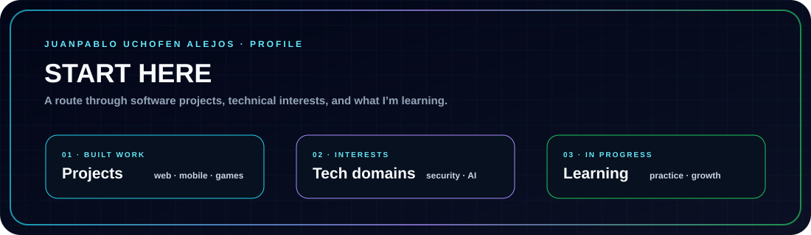
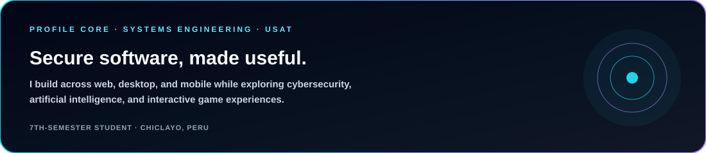
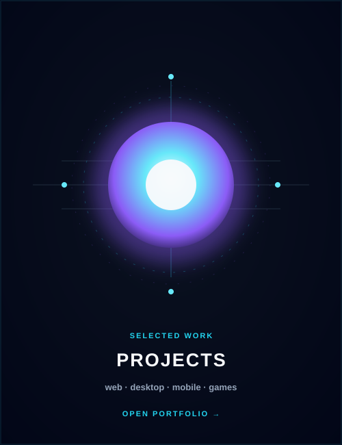
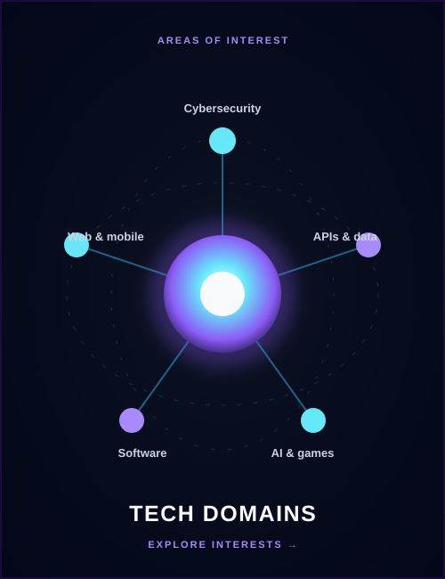
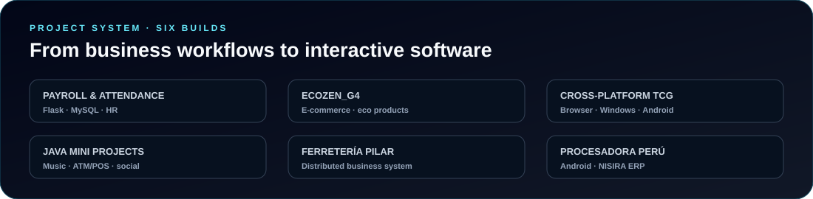
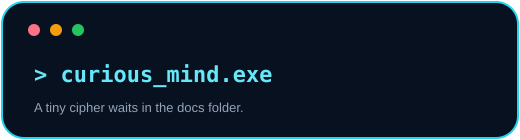

  

<h3 align="center">
  <samp>&gt; Hi, I'm <a href="https://www.linkedin.com/in/juanpablo-jos%C3%A9-uchofen-alejos-53765b27b/">Juanpablo José Uchofen Alejos</a></samp>
</h3>

<samp>Cybersecurity enthusiast · Systems engineering student · Web and software developer</samp>

  
  
  

  

  <a href="./docs/pages/PROJECTS.md"><b>Projects</b></a>
  &nbsp;|&nbsp;
  <a href="./docs/pages/AI_DOMAIN.md"><b>Technical domains</b></a>
  &nbsp;|&nbsp;
  <a href="./docs/pages/LABS.md"><b>Learning focus</b></a>
  &nbsp;|&nbsp;
  <a href="./docs/pages/COLLAB.md"><b>Contact & collaboration</b></a>

---

  

## 👋 About me

I'm a **7th-semester Systems and Computer Engineering student** at **Universidad Católica Santo Toribio de Mogrovejo (USAT)**. I enjoy creating software that combines **functionality, security, and a thoughtful user experience**.

- **Currently learning:** Flask, Power BI, REST API development, secure web architectures, and ethical hacking techniques.
- **Interested in:** Cybersecurity, artificial intelligence, web and mobile development, APIs, databases, and game mechanics.
- **Career goal:** Become a cybersecurity and ethical hacking specialist while developing indie video games as a personal passion.
- **Outside coding:** I enjoy designing game mechanics, learning languages, and exploring emerging technology.

## 🛠 Technologies, Projects, and Domains

<table border="0" cellspacing="10" cellpadding="0">
<tr>
<td width="46%" valign="top" align="center">

<h3>🛠 Technologies</h3>
 

<table align="center" cellspacing="0" cellpadding="6">
  <tr>
    <td align="center"></td>
    <td align="center"></td>
    <td align="center"></td>
    <td align="center"></td>
  </tr>
  <tr>
    <td align="center"></td>
    <td align="center"></td>
    <td align="center"></td>
    <td align="center"></td>
  </tr>
  <tr>
    <td align="center"></td>
    <td align="center"></td>
    <td align="center"></td>
    <td align="center"></td>
  </tr>
  <tr>
    <td align="center"></td>
    <td align="center"></td>
    <td align="center"></td>
    <td align="center"></td>
  </tr>
</table>

 

  
  
  
  
  
  

</td>

<td width="27%" valign="top" align="center">

<h3>🧪 Projects</h3>
 

</td>

<td width="27%" valign="top" align="center">

<h3>🧠 Technical Domains</h3>
 

</td>
</tr>
</table>

## 🚀 Featured projects

  

| Project | Overview | Technologies |
| --- | --- | --- |
| **Payroll & Attendance System** | Human Resources and administrative web application for Inversiones CH Computer SRL. | Python · Flask · MySQL |
| **ECOZEN_G4** | Virtual store for eco-friendly products for gardens, patios, and green areas. | Web development · E-commerce |
| **Cross-platform TCG Game** | Trading card game with rarity-based rewards and collection logic; playable in a browser, Windows, and Android. | Game development · PyInstaller · Capacitor |
| **Java Mini Projects** | Desktop music player, ATM/POS simulator, and mini social network. | Java · Swing |
| **Ferretería Pilar — Distributed Management System** | Web and desktop system for customers, suppliers, products, sales, purchases, inventory, and reports. | Visual Basic .NET · Windows Forms · .NET Framework 4.7.2 · SQL |
| **Procesadora Perú — Internal Orders App** | Native Android app for internal orders, integrating mobile workflows with NISIRA ERP through web services. | Java · Android · ERP integration |

<a href="./docs/pages/PROJECTS.md"><b>Explore the project overview →</b></a>

## 🎓 Certifications & education

<b>View certifications and courses</b>

- **IBM** — Python 101 for Data Science
- **HackerMentor** — Ethical Hacking Hacklab
- **Google Actívate** — Cloud Computing
- **Google Actívate** — Digital Skills for Professionals
- **Google Actívate** — Cybersecurity for Remote Work
- **Organization of American States (OAS)** — Artificial Intelligence
- **Universidad de Piura (UDEP)** — Python Basic & Intermediate
- **USAT** — AI that Learns to Play Video Games by Itself
- **P4H Bionics** — Introduction to Bionic Androids & AI
- **P4H Bionics** — Brain Computer Interfaces
- **P4H Bionics** — 3D Bionic Exoskeleton

## 🌎 Languages

| Language | Proficiency |
| --- | :---: |
| 🇵🇪 Spanish | Native |
| 🇺🇸 English | B2 |
| 🇪🇸 Catalan | B1 |
| 🇹🇷 Turkish | A2 |
| 🇯🇵 Japanese | A1 |
| 🇰🇷 Korean | A1 |
| 🇨🇳 Chinese | A1 |
| 🇵🇭 Tagalog | A1 |

## 📊 GitHub activity

  
  

  

## 🤝 Contact & collaboration

I'm interested in opportunities to learn and contribute around **cybersecurity, ethical hacking, web and mobile software, APIs, databases, artificial intelligence, and indie game development**.

  

  <a href="./docs/pages/COLLAB.md">Collaboration</a> ·
  <a href="./docs/README.md">Documentation</a> ·
  <a href="./.github/CONTRIBUTING.md">Contributing</a> ·
  <a href="./.github/CODE_OF_CONDUCT.md">Code of Conduct</a> ·
  <a href="./.github/SECURITY.md">Security</a>

<em>“Every project is an opportunity to learn something new.”</em>

  

