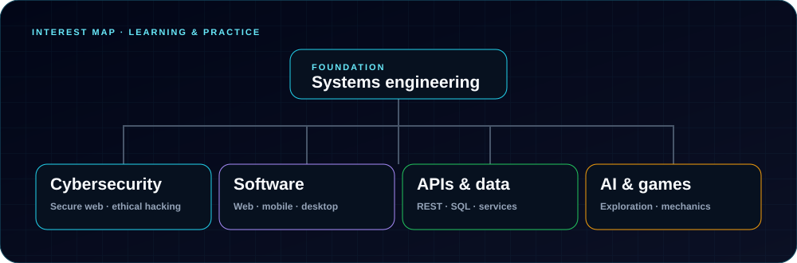

  

  
  
  
  

---

<b>Technical interests connecting secure software, useful applications, and emerging technology.</b>

The areas below come from the profile's stated interests, current learning goals, and described projects. They are learning and career directions—not claims of professional specialization.

## Core Domains

  

### Cybersecurity & ethical hacking

The primary career direction is cybersecurity and ethical hacking. Current learning includes secure web architectures and ethical hacking techniques, supported by an Ethical Hacking Hacklab certificate and a cybersecurity course for remote work.

### Web, mobile & software development

Building web and desktop software is a practical focus across Flask applications, e-commerce, Java desktop apps, Windows Forms, and a native Android application.

### APIs, databases & integration

REST APIs, SQL databases, web services, and ERP integration appear in the learning goals and project work. The Procesadora Perú app connects mobile order workflows to NISIRA ERP.

### Artificial intelligence & data

AI is an area of exploration, reflected in an OAS Artificial Intelligence course, a USAT course on AI learning to play video games, and ongoing interest in Power BI.

### Game development

Indie game development is a personal goal. The cross-platform TCG and interest in game mechanics provide a practical starting point for exploring game logic and player experiences.

## Engineering Principles

| Principle | How it applies |
| --- | --- |
| Build for real workflows | Start from the people and tasks a system should support. |
| Keep security in view | Treat secure architecture as part of web development, not an afterthought. |
| Make integrations understandable | Use clear API and service boundaries between applications. |
| Learn by building | Connect new topics to small, working projects and experiments. |

## Related Pages

- [Projects](./PROJECTS.md)
- [Learning focus](./LABS.md)
- [Collaboration](./COLLAB.md)
