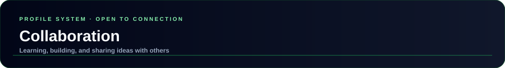
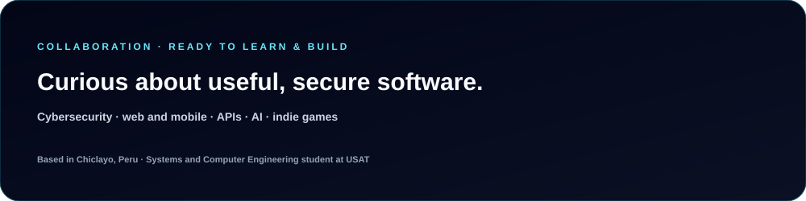

  

  
  
  
  

---

  

I'm a Systems and Computer Engineering student interested in learning through practical work and contributing to useful software. My long-term goal is to specialize in cybersecurity and ethical hacking, while continuing indie game development as a personal passion.

## Areas of Interest

- Cybersecurity, secure web architectures, and ethical hacking.
- Web and mobile application development.
- REST APIs, databases, web services, and system integration.
- Artificial intelligence and data-related tools.
- Game mechanics and indie game development.

## Collaboration Principles

| Signal | What it means |
| --- | --- |
| `CLEAR GOAL` | The problem and intended outcome are understandable. |
| `PRACTICAL` | The work can be explored through a feature, prototype, or concrete task. |
| `SECURITY-MINDED` | Risks and responsible development are considered early. |
| `OPEN TO LEARNING` | Questions, feedback, and knowledge-sharing are welcome. |

## Getting in Touch

For professional connections or collaboration inquiries, reach out through [LinkedIn](https://www.linkedin.com/in/juanpablo-jos%C3%A9-uchofen-alejos-53765b27b/). A helpful first message briefly explains the project, what has been built so far, and the kind of contribution or conversation you're looking for.

  

## Related Pages

- [Projects](./PROJECTS.md)
- [Technical domains](./AI_DOMAIN.md)
- [Learning focus](./LABS.md)
- [Main profile README](../../README.md)
