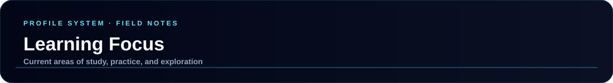
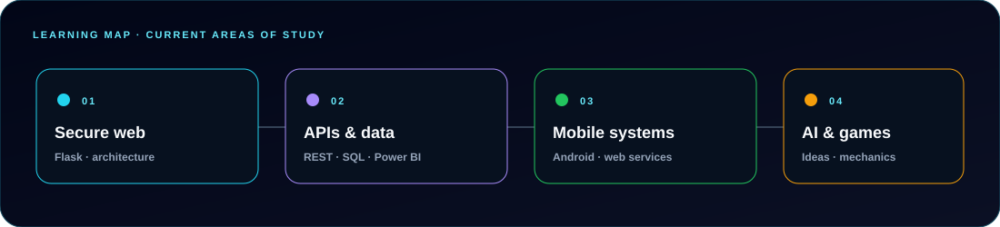

  

  
  
  
  

---

  

This page presents the learning areas listed in the profile README as practical tracks. They are current areas of study and interest, not claims that separate public lab products already exist.

## Current Learning Tracks

| Track | Current focus | Practical connection |
| --- | --- | --- |
| Secure web development | Flask, secure web architectures, and ethical hacking techniques. | Build and review web applications with security considered throughout development. |
| APIs & data | REST API development, SQL databases, and Power BI. | Connect application workflows to data and make information useful. |
| Mobile & enterprise integration | Android development and web services. | Understand how mobile applications communicate with business systems such as NISIRA ERP. |
| AI & interactive systems | Artificial intelligence and game mechanics. | Explore intelligent behavior and the design of engaging game experiences. |

## Learning Approach

1. Strengthen fundamentals through coursework and focused practice.
2. Apply new concepts in a small project or a feature of an existing project.
3. Document what worked, what remains uncertain, and the next improvement.

## Course Highlights

- Python for Data Science and Python fundamentals.
- Ethical hacking and cybersecurity awareness.
- Cloud computing and digital skills.
- Artificial intelligence and bionic technology.

See the full course list in the [main README](../../README.md#-certifications--education), and browse the [project overview](./PROJECTS.md) for examples of hands-on work.
